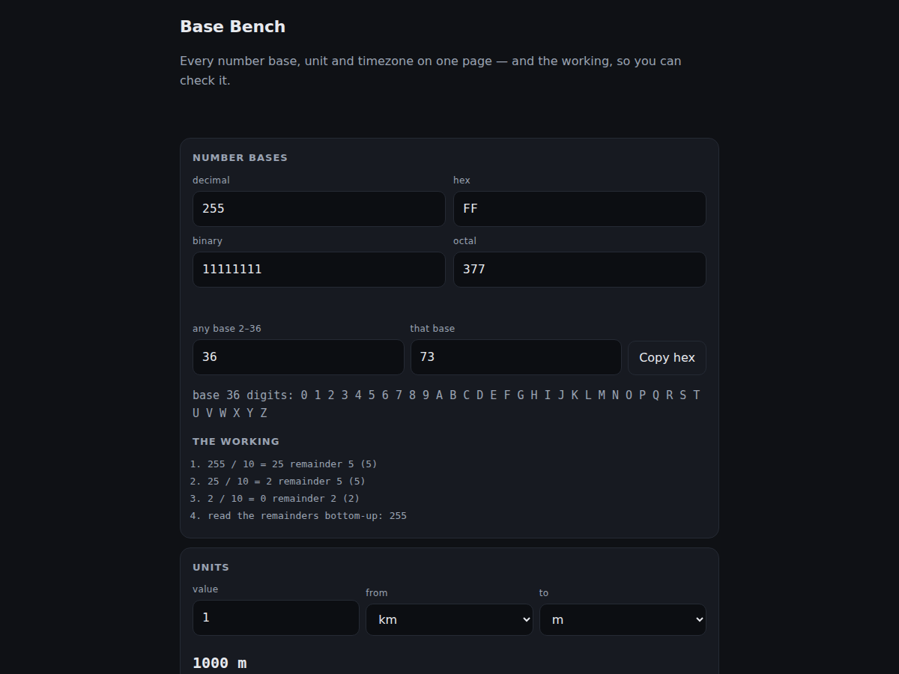

# Base Bench

<!-- shot:start -->

<!-- shot:end -->

[`, `15 / 16 = 0 remainder 15 (F)`, then *read the
  remainders bottom-up: FF*. That is the sum you would do by hand.
- **Units**, with the factor printed: length, mass, data and time, plus
  temperature (which is affine, so it gets its own formula rather than a factor).
  `KB` and `KiB` are kept apart, because they are different units.
- **Timezones** by fixed offset, with the day rollover stated rather than
  swallowed: 01:00 IST is 19:30 UTC **the previous day**.
- **A log** of the conversions you keep, on the device, exportable as CSV.

## What it refuses to do

It is not a scientific calculator. It converts, and it shows how. It also
refuses to invent an answer: an illegal digit, an unknown unit, a length
converted to a mass, or `0x` on base 10 each produce a sentence saying what is
wrong, not a plausible-looking number.

## Run it

Open `docs/play/index.html`. That is the whole app — the kits it uses
(`web-kit.js`, `export-kit.js`) sit next to it, so it works from `file://` and
from GitHub Pages, with no build step and no network.

## The proof

`node test-node.js` — **91 assertions**, no dependencies. The engine is
`docs/play/basebench.js` and the page is a view over it, so testing the engine
tests what the app does. Included are the spec's own done-means (255 shows as
`FF` and `11111111` in the same view, and typing into any field updates the
others), 4,004 round trips across bases 2, 8, 16 and 36, the temperature
fixed-points, and the timezone day rollover.

Each assertion was checked to **bite**: five mutations of the engine (lowercase
digits, the day rollover removed, the `- 32` dropped from the Fahrenheit formula,
the prefix check disabled, the digits reversed) each fail between 1 and 9
assertions.

## Licence

PolyForm Noncommercial 1.0.0 — free for any noncommercial purpose. Commercial use
needs a licence from the author. See [`LICENSE`](LICENSE).

Commercial use requires a paid licence from the author — see [`NOTICE.md`](NOTICE.md).
The engine file noted in its own header stays **MIT**.

