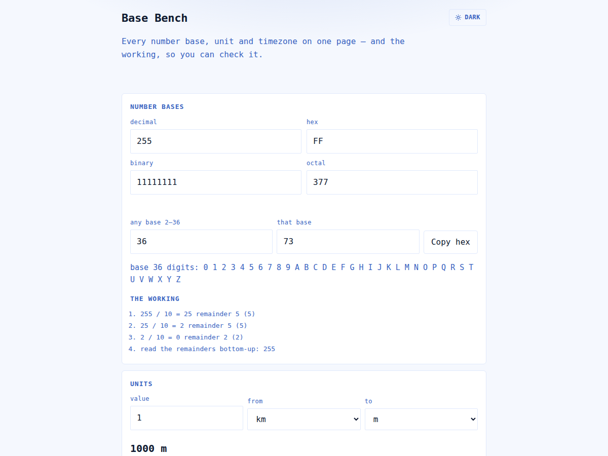

# Base Bench

[](LICENSE)

<p>
  <a href="https://drsamonline.github.io/base-bench/play/"></a>
  <a href="https://github.com/drsamonline/base-bench/actions/workflows/test.yml"></a>
  <a href="https://github.com/drsamonline/base-bench/actions/workflows/build-apps.yml"></a>
  <a href="LICENSE"></a>
  
  
  
</p>

**Every number base, unit and timezone on one page — with the working shown.**

**[Open the bench →](https://drsamonline.github.io/base-bench/play/)** ·
[Landing page](https://drsamonline.github.io/base-bench/) ·
[What it refuses to do](#what-it-refuses-to-do)

<!-- shot:start -->



<!-- shot:end -->

A converter you cannot check is a converter you have to trust. Base Bench shows the
arithmetic at every step, so the answer is verifiable on paper. Offline, no accounts,
no server, no build step, no runtime dependencies — the app is a folder of files you
can open from a USB stick.

Master list **#142** · built from `QUEUE/app-base-bench.md`.

## What it does

| | |
|---|---|
| **Bases, linked** | Decimal, hex, binary and octal are four views of one number. Type in any field and the other three follow, with no reload. Plus any base from 2 to 36, with the legal digit strip printed beside it. |
| **The working, in the base you typed into** | 255 → hex is shown as `255 / 16 = 15 remainder 15 (F)`, `15 / 16 = 0 remainder 15 (F)`, then *read the remainders bottom-up: FF*. That is the sum you would do by hand. |
| **Units, with the factor** | Length, mass, data and time carry their factor in the working line. Temperature is affine, so it gets its own formula rather than a factor. `KB` and `KiB` are kept apart, because they are different units. |
| **Timezones, with the rollover** | Fixed offsets, stated as fixed. The day change is said out loud rather than swallowed: 01:00 IST is 19:30 UTC **the previous day**. |
| **A log, on the device** | The conversions you keep live in this browser's storage and leave only when you export them as CSV. |
| **Any length of integer** | The whole part is carried as a BigInt, so a 30-digit number is read and written exactly. A double would start rounding at 2^53 and print a plausible answer that is not the one you typed. |
| **Three languages** | English, Hindi and Gujarati — every label, every note and every refusal. The choice is remembered on the device, and the arithmetic does not change with it. |
| **Installs as an app** | A service worker keeps the shell on the device and serves the HTML *network-first*, so a new release can never hide behind a cache. Add to home screen from the browser menu — no store, no account. |

## What it refuses to do

- **Not a scientific calculator.** It converts, and it shows how. Anything else is a different tool.
- **No invented answers.** An illegal digit, an unknown unit, a length converted to a mass, or `0x` on base 10 each produce a sentence saying what is wrong — not a plausible-looking number. Where a double would round, the bench does not round: it carries a BigInt instead.
- **No network at any point.** No fetch, no CDN, no font service, no analytics. The page carries everything it needs, and the test suite asserts it.
- **No account, no sync, no telemetry.** Nothing leaves the device unless you export it.

## Take it with you

| | Asset | What it is |
|---|---|---|
|  | [`base-bench.apk`](https://github.com/drsamonline/base-bench/releases/download/app-latest/base-bench.apk) | Android WebView build, signed |
|  | [`base-bench-portable.exe`](https://github.com/drsamonline/base-bench/releases/download/app-latest/base-bench-portable.exe) | one portable Windows binary, no installer |
|  | [`base-bench-linux`](https://github.com/drsamonline/base-bench/releases/download/app-latest/base-bench-linux) | Linux binary |

Every asset on the [releases page](https://github.com/drsamonline/base-bench/releases)
is built from the same commit as the live page, so the demo and the download can never
disagree.

## Run it

```bash
git clone https://github.com/drsamonline/base-bench
open docs/play/index.html      # the whole app
node test-node.js              # 116 assertions, no installs
```

## The proof

`node test-node.js` — **116 assertions**, no dependencies. Sixteen of them are the
dictionary itself: every key in every language, every refusal code the engine can emit
written out in all three, and every phrase the page tags for translation actually present. The engine is
`docs/play/basebench.js` and the page is a view over it, so testing the engine tests
what the app does. Included are the spec's own done-means (255 shows as `FF` and
`11111111` in the same view, and typing into any field updates the others), 4,004 round
trips across bases 2, 8, 16 and 36, the temperature fixed-points, and the timezone day
rollover.

Each assertion was checked to **bite**: five mutations of the engine (lowercase digits,
the day rollover removed, the `- 32` dropped from the Fahrenheit formula, the prefix
check disabled, the digits reversed) each fail between 1 and 9 assertions.

## Layout

```
docs/index.html              the landing page - its own design, not the app's
docs/play/index.html         the app
docs/play/basebench.js       the engine: bases, units, timezones
docs/play/sw.js              the offline shell: network-first HTML, cache-first assets
docs/play/manifest.webmanifest  what makes it installable, and its icons
docs/play/icon-*.png         the launcher icons, drawn locally
docs/play/web-kit.js         storage, theme, i18n, a11y
docs/play/export-kit.js      the CSV export
docs/assets/badge-*.svg      badges, drawn locally by tools/badges.py
docs/assets/app-*.png        screenshots of the real page
docs/shot.png                the pipeline's own screenshot (rewritten on every build)
release-notes.md             the release page's own notes: an icon per asset
test-node.js                 the proof
tools/badges.py              regenerates the badges - no image service involved
```

The page carries a `Content-Security-Policy` of `default-src 'none'` with
`connect-src 'none'`, so "no network" is enforced by the browser rather than only asserted by
the suite. Bump `CACHE` in `docs/play/sw.js` and the build stamp in the footers on every
release — the worker serves HTML network-first precisely so that a stale cache cannot hide a
release, but the two stamps are what make "am I on the new one?" answerable from the page.

The badges are drawn by `python3 tools/badges.py`, not fetched from a badge service:
an offline-first app that needs the network to say "no network" has broken its own rule.
If the suite stops printing 116, change the number in `tools/badges.py` in the same commit.

## Support


Free, offline, accountless — and staying that way. If it earned its keep:

| | |
|---|---|
| UPI (India) | `drsohilboi@ybl` — payee Dr. Sohil Momin, open amount, or scan [the QR](docs/assets/upi-qr.svg) |
| Ko-fi | [ko-fi.com/matneo](https://ko-fi.com/matneo) |
| PayPal | [paypal.me/drsohilmomin](https://paypal.me/drsohilmomin?locale.x=en_GB&country.x=IN) |
| My books | [Amazon author store](https://www.amazon.com/stores/author/B08ZT331LY/allbooks?ccs_id=aed72b9f-71d9-41dc-adee-e9368a317acc) |
| More apps | [drsamonline.github.io](https://drsamonline.github.io/) |
| Email | [sohilmomin2000@gmail.com](mailto:sohilmomin2000@gmail.com) |

Nothing is gated behind it: no accounts, no tracking, no network requests.

## Licence

PolyForm Noncommercial 1.0.0 — free for any noncommercial purpose. Commercial use needs
a licence from the author; see [`LICENSE`](LICENSE) and [`NOTICE.md`](NOTICE.md). The
engine file noted in its own header stays **MIT**.
